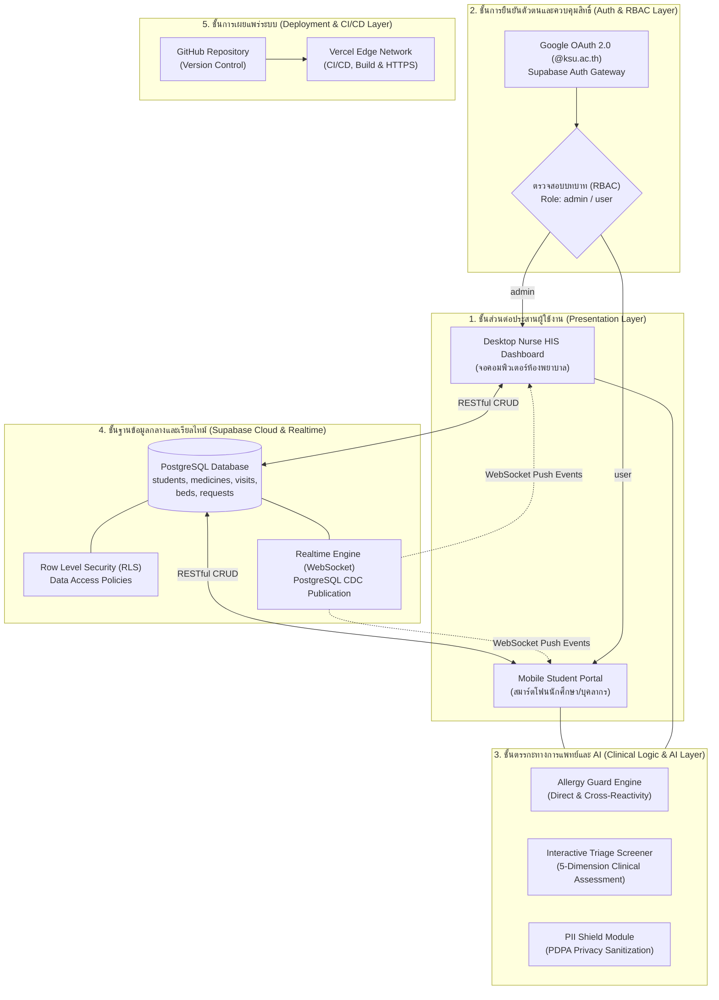
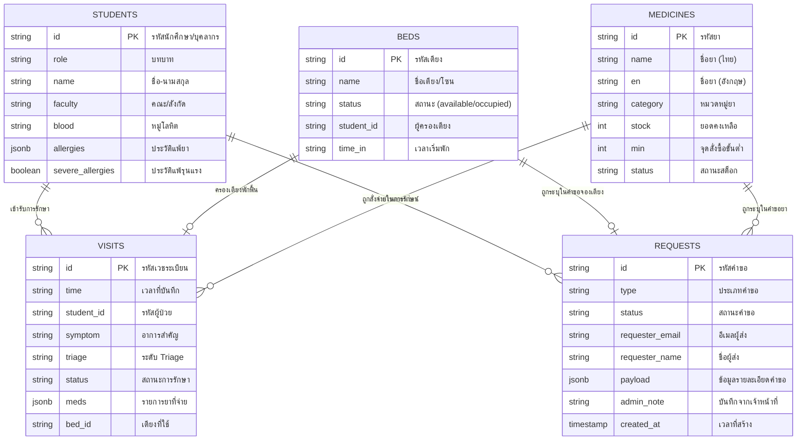
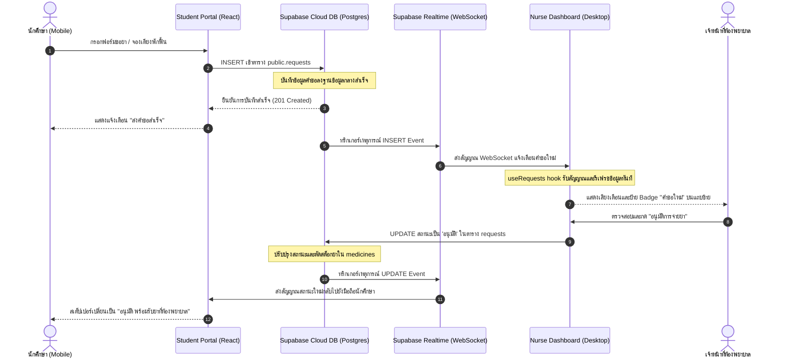
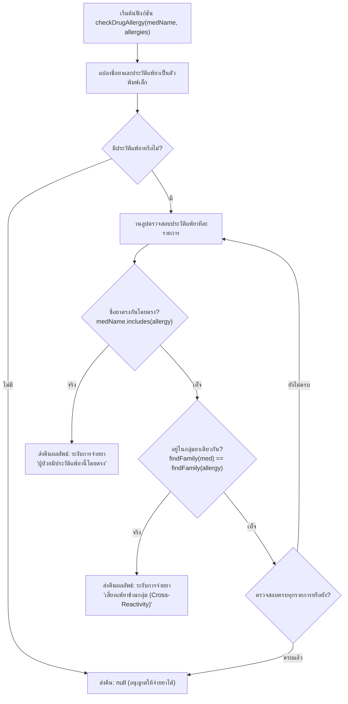

# บทที่ 3
# วิธีดำเนินโครงงาน

การจัดทำโครงงานระบบบริหารจัดการห้องพยาบาลอัจฉริยะร่วมกับปัญญาประดิษฐ์คัดกรองอาการและระบบตรวจสอบการแพ้ยา ยูนิแคร์ (UniCare Intelligent Nursing System) มหาวิทยาลัยกาฬสินธุ์ คณะผู้จัดทำได้กำหนดขั้นตอนและวิธีดำเนินโครงงานอย่างเป็นระบบตามระเบียบวิธีวิจัยและพัฒนาซอฟต์แวร์วิศวกรรมคอมพิวเตอร์ (Software Engineering Methodology) โดยมุ่งเน้นความปลอดภัยทางคลินิก (Clinical Safety) การปกป้องข้อมูลส่วนบุคคลตามกฎหมาย PDPA การเชื่อมต่อฐานข้อมูลกลางบนระบบคลาวด์แบบเรียลไทม์ (Centralized Cloud Database & Realtime Sync) และการออกแบบที่รองรับการใช้งานจริงผ่านทุกอุปกรณ์ (Responsive & Mobile-First HIS) โดยแบ่งการดำเนินงานออกเป็นหัวข้อหลัก ดังนี้

---

## 3.1 แผนการดำเนินงานโครงงาน (Project Timeline & Operational Plan)

การดำเนินโครงงานได้กำหนดกรอบระยะเวลาตลอดปีการศึกษา รวมระยะเวลา 8 เดือน โดยแบ่งขั้นตอนการดำเนินงานออกเป็น 5 ระยะหลัก (5 Phases) ดังนี้

### 3.1.1 การศึกษา วิเคราะห์ปัญหา และรวบรวมความต้องการ (Requirement Engineering & Research)
1. ศึกษาปัญหาและกระบวนการทำงานจริงของห้องพยาบาล มหาวิทยาลัยกาฬสินธุ์ ทั้งขั้นตอนการลงทะเบียน ซักประวัติ การจ่ายยา การครองเตียงพักฟื้น และการส่งต่อผู้ป่วยฉุกเฉิน
2. ศึกษาเภสัชวิทยาเกี่ยวกับโครงสร้างโมเลกุลยาและการเกิดปฏิกิริยาแพ้ยาข้ามกลุ่ม (Drug Allergy Cross-Reactivity) เช่น ยาในกลุ่ม Penicillins, Cephalosporins, Sulfonamides และ NSAIDs
3. ศึกษาระบบคัดกรองระดับความเร่งด่วนทางการแพทย์ (Emergency Severity Index & Triage Assessment Protocol)
4. ศึกษาพระราชบัญญัติคุ้มครองข้อมูลส่วนบุคคล พ.ศ. 2562 (PDPA) เพื่อออกแบบระบบนิรนามข้อมูลผู้ป่วย (PII De-identification)

### 3.1.2 การออกแบบสถาปัตยกรรมระบบและฐานข้อมูล (Architecture & Database Design)
1. ออกแบบสถาปัตยกรรมระบบภาพรวมแบบ 5 ลำดับชั้น (5-Tier Cloud & Realtime Architecture)
2. ออกแบบฐานข้อมูลเชิงสัมพันธ์ (Relational Database) บน Supabase PostgreSQL ครอบคลุม 5 ตารางหลัก ได้แก่ ผู้ป่วย คลังยา ประวัติการรักษา ผังเตียง และคำขอออนไลน์
3. ออกแบบความปลอดภัยในการเข้าถึงข้อมูลด้วย Row Level Security (RLS) และระบบยืนยันตัวตนด้วย Google OAuth 2.0 ภายใต้โดเมนมหาวิทยาลัยกาฬสินธุ์ (`@ksu.ac.th`)
4. ออกแบบอัลกอริทึมการตรวจสอบการแพ้ยาข้ามกลุ่ม การประเมิน Triage และการซิงค์ข้อมูลข้ามอุปกรณ์แบบเรียลไทม์ผ่าน WebSocket

### 3.1.3 การพัฒนาซอฟต์แวร์และโมดูลการทำงาน (System Implementation)
1. พัฒนาส่วนหน้าบ้าน (Frontend) ด้วย React 18 ร่วมกับ TypeScript และ Tailwind CSS โดยใช้การออกแบบ Responsive Mobile-First และสไตล์ Professional Hospital Information System (HIS)
2. พัฒนาโมดูลความปลอดภัยทางการแพทย์และปัญญาประดิษฐ์ในไฟล์ `src/ai.ts` แบบ Local-First Rule-Based Engine
3. พัฒนาระบบเชื่อมต่อฐานข้อมูลคลาวด์และ Realtime Subscription ในไฟล์ `src/supabase.ts` และ `src/requests.ts`
4. พัฒนาระบบยืนยันตัวตนและการจัดการสิทธิ์ตามบทบาท (RBAC) ในไฟล์ `src/auth.ts`

### 3.1.4 การทดสอบระบบและการประเมินผล (Testing & Verification)
1. ทดสอบความถูกต้องของตรรกะการตรวจจับการแพ้ยาตรงตัวและแพ้ยาข้ามกลุ่ม (Unit Testing)
2. ทดสอบความแม่นยำในการคัดกรองความเร่งด่วนของ AI เทียบกับเกณฑ์มาตรฐานทางการแพทย์
3. ทดสอบการตัดยอดคลังยาและการบริหารเตียงพักฟื้นแบบเรียลไทม์
4. ทดสอบการส่งคำขอและการประสานข้อมูลข้ามอุปกรณ์ (Cross-Device Integration Testing) ระหว่างโทรศัพท์มือถือนักศึกษากับคอมพิวเตอร์เจ้าหน้าที่ห้องพยาบาล
5. ทดสอบการทำงานของระบบ CI/CD บน Vercel Cloud Platform

### 3.1.5 การสรุปผลและจัดทำรายงานปริญญานิพนธ์ (Documentation & Evaluation)
1. รวบรวมผลการทดสอบ ประเมินความพึงพอใจของผู้ใช้งาน และวิเคราะห์ข้อจำกัดของระบบ
2. จัดทำรูปเล่มปริญญานิพนธ์และเอกสารคู่มือการใช้งานระบบ
3. เตรียมการนำเสนอโครงงานต่อคณะกรรมการสอบปริญญานิพนธ์

**ตารางที่ 3.1** แผนการดำเนินงานโครงงานตลอดปีการศึกษา (8 เดือน)

| กิจกรรม / ขั้นตอนการดำเนินงาน | เดือนที่ 1 | เดือนที่ 2 | เดือนที่ 3 | เดือนที่ 4 | เดือนที่ 5 | เดือนที่ 6 | เดือนที่ 7 | เดือนที่ 8 |
| :--- | :---: | :---: | :---: | :---: | :---: | :---: | :---: | :---: |
| 1. ศึกษาความต้องการ ทฤษฎี และเกณฑ์ทางการแพทย์ | ■ | ■ | | | | | | |
| 2. ออกแบบสถาปัตยกรรม โครงสร้าง DB และผังงาน | | ■ | ■ | | | | | |
| 3. พัฒนาตรรกะ AI ตรวจแพ้ยาและคัดกรอง Triage | | | ■ | ■ | | | | |
| 4. พัฒนาหน้าจอพยาบาล (HIS) และพอร์ทัลนักศึกษา | | | | ■ | ■ | | | |
| 5. พัฒนาระบบฐานข้อมูล Supabase และ Realtime | | | | | ■ | ■ | | |
| 6. ติดตั้งบน Vercel และเชื่อมต่อ Google OAuth | | | | | | ■ | ■ | |
| 7. ทดสอบการซิงค์ข้ามอุปกรณ์และประเมินผล | | | | | | | ■ | ■ |
| 8. จัดทำเอกสารปริญญานิพนธ์ฉบับสมบูรณ์ | | | | | | | | ■ |

---

## 3.2 สถาปัตยกรรมระบบภาพรวม (System Architecture Design)

สถาปัตยกรรมของระบบยูนิแคร์ได้รับการออกแบบให้เป็น **ระบบคลาวด์และเรียลไทม์ 5 ลำดับชั้น (5-Tier Cloud & Realtime Architecture)** ที่รองรับการประมวลผลทั้งในโหมดออนไลน์เต็มรูปแบบ (Cloud-First) และมีระบบสำรองข้อมูลออฟไลน์ชั่วคราว (Offline-Resilient Cache) โดยแบ่งออกเป็นลำดับชั้นการทำงาน ดังนี้

### 3.2.1 ชั้นส่วนต่อประสานผู้ใช้งาน (Presentation & Client Layer)
พัฒนาด้วยเทคโนโลยี Single Page Application (SPA) บนสถาปัตยกรรม Responsive Web Application รองรับการแสดงผลทุกขนาดหน้าจอ (Mobile, Tablet, Desktop) โดยแบ่งออกเป็น 2 มุมมองหลัก:
1. **Nurse HIS Dashboard (มุมมองเจ้าหน้าที่ห้องพยาบาล):** หน้าจอมาตรฐานระบบสารสนเทศโรงพยาบาล แบ่ง 2 คอลัมน์ (Split Workspace) ประกอบด้วย ตารางบันทึกการรักษาล่าสุด, ผังเตียงพักฟื้น 7 เตียง, รายการเฝ้าระวังกลุ่มเสี่ยงและแพ้ยา, ระบบบันทึกเวชระเบียน, ระบบคลังยา, รายงานสถิติ และหน้าจัดการคำขอออนไลน์
2. **Student & Personnel Portal (มุมมองนักศึกษาและบุคลากร):** ออกแบบตามแนวคิด Mobile-First ประกอบด้วย บัตรสุขภาพดิจิทัล (Digital Health Card), ระบบจองเตียงพักฟื้น, ระบบขอยาตามอาการ, ระบบแจ้งประวัติแพ้ยาด้วยตนเอง, ปุ่มเรียกความช่วยเหลือฉุกเฉิน (Emergency Call) และแถบติดตามสถานะคำขอเรียลไทม์

### 3.2.2 ชั้นการยืนยันตัวตนและการควบคุมสิทธิ์ (Authentication & RBAC Layer)
จัดการการเข้าถึงระบบผ่าน Supabase Auth ร่วมกับ Google OAuth 2.0 โดยมีเงื่อนไขตรวจสอบสิทธิ์อย่างเข้มงวด:
1. บังคับใช้อีเมลมหาวิทยาลัยกาฬสินธุ์ที่ลงท้ายด้วย `@ksu.ac.th` เท่านั้น หากเป็นอีเมลภายนอกระบบจะปฏิเสธการเข้าใช้งานทันที
2. จำแนกสิทธิ์ตามบทบาท (Role-Based Access Control: RBAC) ระหว่าง `admin` (เจ้าหน้าที่ห้องพยาบาล) และ `user` (นักศึกษาและบุคลากรทั่วไป) เพื่อป้องกันไม่ให้ผู้ใช้ทั่วไปเข้าถึงเวชระเบียนหรือข้อมูลหลังบ้าน

### 3.2.3 ชั้นตรรกะความปลอดภัยทางการแพทย์และ AI (Clinical Logic & Local AI Engine)
ทำงานบนฝั่งเครื่องไคลเอนต์ (Local Processing) เพื่อความรวดเร็วและคุ้มครองข้อมูลส่วนบุคคล:
1. **โมดูล Allergy Guard:** ตรวจสอบการแพ้ยาโดยตรงและแพ้ยาข้ามกลุ่มเคมี (Cross-Reactivity)
2. **โมดูล Interactive Triage:** ประเมินระดับความเร่งด่วนของอาการผ่านแบบสอบถาม 5 มิติ
3. **โมดูล PII Shield:** ตัดข้อมูลระบุตัวตน (ชื่อ, รหัสนักศึกษา, หมายเลขโทรศัพท์) ก่อนนำข้อความอาการไปวิเคราะห์

### 3.2.4 ชั้นฐานข้อมูลกลางและการสื่อสารแบบเรียลไทม์ (Centralized Cloud Database & Realtime Layer)
ใช้ฐานข้อมูล PostgreSQL บนระบบคลาวด์ของ Supabase เป็นศูนย์กลางข้อมูลเพียงแห่งเดียว (Single Source of Truth) ทุกอุปกรณ์จะอ่านและเขียนข้อมูลชุดเดียวกัน โดยมีช่องทางการเชื่อมต่อ 2 รูปแบบ:
1. **RESTful API (PostgREST):** ใช้สำหรับคำสั่งสืบค้น บันทึก แก้ไข และลบข้อมูล (CRUD Operations) ภายใต้การควบคุมของ Row Level Security (RLS)
2. **Realtime WebSocket (Supabase Realtime Channel):** ใช้เทคโนโลยี PostgreSQL Change Data Capture (CDC) รับ-ส่งเหตุการณ์เมื่อมีการเปลี่ยนแปลงข้อมูลในตาราง `requests` ไปยังทุกอุปกรณ์ที่เชื่อมต่ออยู่ทันทีในระดับมิลลิวินาที

### 3.2.5 ชั้นการติดตั้งและการเผยแพร่ระบบ (Hosting & Edge Deployment Layer)
ติดตั้งซอร์สโค้ดบน Vercel Cloud Platform โดยเชื่อมต่อกับ GitHub ผ่านกระบวนการ CI/CD มีการกำหนดค่า Single Page Application Rewrite ในไฟล์ `vercel.json` เพื่อรองรับการเข้าถึงเส้นทาง URL ตรง (`/admin`, `/portal`) และให้บริการผ่านโปรโตคอลความปลอดภัย HTTPS พร้อมเครือข่าย CDN (Edge Network)


**ภาพที่ 3.1** แผนภาพสถาปัตยกรรมระบบยูนิแคร์ภาพรวม (UniCare 5-Tier Cloud & Realtime Architecture)

---

## 3.3 การออกแบบฐานข้อมูลกลาง (Centralized Database & Schema Design)

ฐานข้อมูลของระบบยูนิแคร์ได้รับการออกแบบและจัดเก็บบนระบบจัดการฐานข้อมูลเชิงสัมพันธ์ **PostgreSQL บน Supabase Cloud Platform** (`https://sjdnvqosivwyxhsqbftd.supabase.co`) เพื่อทำหน้าที่เป็นศูนย์กลางข้อมูลสำหรับทุกอุปกรณ์ ประกอบด้วย 5 ตารางหลัก ดังนี้

### 3.3.1 ตารางทะเบียนผู้รับบริการ (Table: `students`)
ใช้จัดเก็บข้อมูลระบุตัวตน ประวัติสุขภาพ และประวัติการแพ้ยาของนักศึกษา อาจารย์ และบุคลากร

```sql
CREATE TABLE IF NOT EXISTS public.students (
  id TEXT PRIMARY KEY,                       -- รหัสนักศึกษา หรือรหัสบุคลากร
  role TEXT DEFAULT 'นักศึกษา',               -- บทบาท (นักศึกษา, อาจารย์, บุคลากร)
  name TEXT NOT NULL,                        -- ชื่อ-นามสกุล
  first_name TEXT,                           -- ชื่อ
  last_name TEXT,                            -- นามสกุล
  faculty TEXT,                              -- คณะ / สังกัด
  department TEXT,                           -- สาขาวิชา / ภาควิชา
  year TEXT,                                 -- ชั้นปี
  blood TEXT,                                -- หมู่โลหิต (A, B, O, AB)
  phone TEXT,                                -- หมายเลขโทรศัพท์
  allergies JSONB DEFAULT '[]'::jsonb,       -- รายการยาที่แพ้ (Array of strings)
  allergy_reaction TEXT,                     -- อาการแพ้ยาที่เคยพบ
  severe_allergies BOOLEAN DEFAULT FALSE,    -- ประวัติการแพ้ยารุนแรง (Anaphylaxis Risk)
  emergency_contact TEXT,                    -- ข้อมูลติดต่อกรณีฉุกเฉิน
  visits_count INTEGER DEFAULT 0,            -- จำนวนครั้งที่เข้ารับบริการสะสม
  created_at TIMESTAMPTZ DEFAULT NOW()       -- วันที่ลงทะเบียน
);
```

### 3.3.2 ตารางคลังยาและเวชภัณฑ์ (Table: `medicines`)
ใช้จัดเก็บรายการยาและเวชภัณฑ์ในห้องพยาบาล เพื่อควบคุมสต็อกและตรวจสอบการจ่ายยา

```sql
CREATE TABLE IF NOT EXISTS public.medicines (
  id TEXT PRIMARY KEY,                       -- รหัสยา (เช่น MED-001)
  name TEXT NOT NULL,                        -- ชื่อยาภาษาไทย/ชื่อทางการค้า
  en TEXT,                                   -- ชื่อสามัญทางยาภาษาอังกฤษ (Generic Name)
  category TEXT,                             -- หมวดหมู่ (ยารับประทาน, ยาใช้ภายนอก, เวชภัณฑ์)
  stock INTEGER DEFAULT 0,                   -- ปริมาณคงคลังปัจจุบัน
  min INTEGER DEFAULT 0,                     -- จุดสั่งซื้อขั้นต่ำ (Reorder Point)
  unit TEXT,                                 -- หน่วยนับ (เม็ด, แผง, ขวด, ซอง)
  lot TEXT,                                  -- หมายเลขรุ่นการผลิต (Lot Number)
  expiry TEXT,                               -- วันหมดอายุ (YYYY-MM-DD)
  status TEXT DEFAULT 'ปกติ',                 -- สถานะสต็อก (ปกติ, เหลือน้อย, วิกฤต, หมดสต็อก)
  updated_at TIMESTAMPTZ DEFAULT NOW()       -- เวลาที่อัปเดตสต็อกล่าสุด
);
```

### 3.3.3 ตารางประวัติการเข้ารับบริการและการจ่ายยา (Table: `visits`)
ใช้บันทึกเวชระเบียนการรักษาในแต่ละครั้งที่ผู้รับบริการเข้ามายังห้องพยาบาล

```sql
CREATE TABLE IF NOT EXISTS public.visits (
  id TEXT PRIMARY KEY,                       -- รหัสการรักษา (เช่น VST-1001)
  time TEXT,                                 -- เวลาที่บันทึก (เช่น 09:30 น.)
  patient_id TEXT,                           -- รหัสผู้รับบริการ
  student_id TEXT,                           -- รหัสประจำตัว (เพื่อความเข้ากันได้)
  student_name TEXT,                         -- ชื่อ-นามสกุลผู้รับบริการ
  patient_role TEXT,                         -- ประเภทผู้รับบริการ
  faculty TEXT,                              -- คณะ / สังกัด
  department TEXT,                           -- สาขาวิชา
  symptom TEXT,                              -- อาการสำคัญ (Chief Complaint)
  triage TEXT,                               -- ระดับความเร่งด่วน (ฉุกเฉิน, ด่วน, ปกติ)
  status TEXT,                               -- สถานะการรักษา (รอพบพยาบาล, กำลังพักฟื้น, รักษาแล้ว)
  diagnosis TEXT,                            -- การวินิจฉัยโรคเบื้องต้น
  meds JSONB DEFAULT '[]'::jsonb,            -- รายการยาที่สั่งจ่าย (Array)
  bed_id TEXT,                               -- รหัสเตียงที่ครองพักฟื้น (ถ้ามี)
  allergies JSONB DEFAULT '[]'::jsonb,       -- ประวัติแพ้ยาขณะเข้ารักษา
  allergy_reaction TEXT,                     -- อาการแพ้ที่ระบุ
  created_at TIMESTAMPTZ DEFAULT NOW()       -- วันที่และเวลาที่บันทึก
);
```

### 3.3.4 ตารางผังเตียงพักฟื้น (Table: `beds`)
ใช้ควบคุมสถานะการครองเตียงพักฟื้นของห้องพยาบาลแบบเรียลไทม์

```sql
CREATE TABLE IF NOT EXISTS public.beds (
  id TEXT PRIMARY KEY,                       -- รหัสเตียง (เช่น BED-01 ถึง BED-07)
  name TEXT NOT NULL,                        -- ชื่อเตียง (เช่น เตียง 1 (โซนชาย))
  status TEXT DEFAULT 'available',           -- สถานะเตียง (available = ว่าง, occupied = ไม่ว่าง)
  student_id TEXT,                           -- รหัสผู้ป่วยที่กำลังครองเตียง
  student_name TEXT,                         -- ชื่อผู้ป่วยที่กำลังครองเตียง
  symptom TEXT,                              -- อาการของผู้ป่วยที่ครองเตียง
  time_in TEXT,                              -- เวลาที่เริ่มเข้าพักฟื้น
  updated_at TIMESTAMPTZ DEFAULT NOW()       -- เวลาที่มีการปรับสถานะเตียง
);
```

### 3.3.5 ตารางคำขอออนไลน์จากนักศึกษาและบุคลากร (Table: `requests`)
ตารางข้อมูลกลางที่ใช้รับ-ส่งคำขอระหว่างหน้าจอนักศึกษาบนมือถือและหน้าจอพยาบาลบนคอมพิวเตอร์

```sql
CREATE TABLE IF NOT EXISTS public.requests (
  id TEXT PRIMARY KEY,                       -- รหัสคำขอ (เช่น REQ-MWNA92GO)
  type TEXT NOT NULL,                        -- ประเภท (bed, medicine, allergy, emergency)
  status TEXT DEFAULT 'รอดำเนินการ',           -- สถานะ (รอดำเนินการ, อนุมัติ, ปฏิเสธ, รับทราบ, เสร็จสิ้น)
  requester_email TEXT,                      -- อีเมลผู้ส่งคำขอ (@ksu.ac.th)
  requester_name TEXT,                       -- ชื่อ-นามสกุลผู้ส่งคำขอ
  requester_role TEXT,                       -- บทบาทผู้ส่งคำขอ (นักศึกษา, อาจารย์, บุคลากร)
  payload JSONB DEFAULT '{}'::jsonb,         -- รายละเอียดเฉพาะของคำขอในรูปแบบ JSON
  admin_note TEXT,                           -- ข้อความหรือหมายเหตุตอบกลับจากเจ้าหน้าที่
  created_at TIMESTAMPTZ DEFAULT NOW(),      -- เวลาที่ส่งคำขอ
  updated_at TIMESTAMPTZ DEFAULT NOW()       -- เวลาที่มีการอัปเดตสถานะคำขอ
);
```

### 3.3.6 นโยบายความปลอดภัยและ Realtime Publication
เปิดใช้งาน Row Level Security (RLS) เพื่อควบคุมความปลอดภัยของข้อมูล และเปิดระบบ Realtime สำหรับกระจายข้อมูลคำขอ:

```sql
-- เปิดการใช้งาน Row Level Security (RLS) ทุกตาราง
ALTER TABLE public.students ENABLE ROW LEVEL SECURITY;
ALTER TABLE public.medicines ENABLE ROW LEVEL SECURITY;
ALTER TABLE public.visits ENABLE ROW LEVEL SECURITY;
ALTER TABLE public.beds ENABLE ROW LEVEL SECURITY;
ALTER TABLE public.requests ENABLE ROW LEVEL SECURITY;

-- กำหนดนโยบายการเข้าถึงข้อมูล (Policies)
CREATE POLICY "Allow public access students" ON public.students FOR ALL USING (true) WITH CHECK (true);
CREATE POLICY "Allow public access medicines" ON public.medicines FOR ALL USING (true) WITH CHECK (true);
CREATE POLICY "Allow public access visits" ON public.visits FOR ALL USING (true) WITH CHECK (true);
CREATE POLICY "Allow public access beds" ON public.beds FOR ALL USING (true) WITH CHECK (true);
CREATE POLICY "Allow public access requests" ON public.requests FOR ALL USING (true) WITH CHECK (true);

-- เปิดใช้งาน Realtime Change Data Capture (CDC) สำหรับตาราง requests
ALTER PUBLICATION supabase_realtime ADD TABLE public.requests;
```


**ภาพที่ 3.2** ผังความสัมพันธ์โครงสร้างข้อมูลบนฐานข้อมูล Supabase (Entity Relationship Diagram)

---

## 3.4 กลไกการสื่อสารข้ามอุปกรณ์และการประสานข้อมูลแบบเรียลไทม์ (Cross-Device Realtime Synchronization)

หนึ่งในคุณสมบัติที่สำคัญที่สุดของระบบยูนิแคร์คือการทำงานร่วมกันระหว่าง **นักศึกษาที่ใช้งานผ่านโทรศัพท์มือถือ** และ **เจ้าหน้าที่ห้องพยาบาลที่ใช้งานผ่านคอมพิวเตอร์ตั้งโต๊ะ** โดยข้อมูลจะต้องตรงกัน 100% ทันทีที่มีการดำเนินการใด ๆ

### 3.4.1 วงจรชีวิตของคำขอ (Request Lifecycle Workflow)
1. **การสร้างคำขอ (Request Creation):** นักศึกษากรอกข้อมูลคำขอบนมือถือ (เช่น ขอยาพาราเซตามอล หรือขอจองเตียงพักฟื้น) ฟังก์ชัน `createRequest` ใน `src/requests.ts` จะส่งคำสั่ง `INSERT` ไปยัง Supabase Cloud โดยตรง
2. **การกระจายสัญญาณเรียลไทม์ (Realtime Event Broadcast):** เมื่อ PostgreSQL บันทึกแถวข้อมูลใหม่ลงในตาราง `public.requests` สำเร็จ เอนจิน Supabase Realtime จะส่งข้อความเหตุการณ์ `INSERT` ผ่านช่องทาง WebSocket ไปยังเบราว์เซอร์ของพยาบาลทันที
3. **การรับรู้และการแจ้งเตือน (Instant Alert & Notification):** ฟังก์ชัน `useRequests` บนหน้าจอคอมพิวเตอร์ของพยาบาลซึ่งผูก Listener ไว้กับ `public:requests-realtime` จะเรียกฟังก์ชัน `refresh()` เพื่อนำข้อมูลใหม่เข้าสู่สถานะของ React อัตโนมัติ พร้อมส่งเสียงเตือนและแสดง Toast Notification
4. **การพิจารณาและการตอบกลับ (Action & State Transition):** พยาบาลตรวจสอบความถูกต้อง (เช่น ตรวจสอบประวัติแพ้ยา หรือผังเตียงว่าง) แล้วกดปุ่ม "อนุมัติ" หรือ "ปฏิเสธ" ฟังก์ชัน `updateRequest` จะส่งคำสั่ง `UPDATE` ไปยัง Supabase
5. **การอัปเดตสถานะบนมือถือนักศึกษา:** เมื่อข้อมูลในตารางเปลี่ยน สถานะคำขอบนแถบความคืบหน้า (Progress Stepper) ในมือถือของนักศึกษาจะเปลี่ยนเป็น "อนุมัติแล้ว พร้อมรับยา" หรือ "จัดเตียงให้แล้ว" ในทันที


**ภาพที่ 3.3** แผนภาพลำดับขั้นตอนการซิงค์ข้อมูลคำขอข้ามอุปกรณ์แบบเรียลไทม์ (Cross-Device Sequence Diagram)

### 3.4.2 การจัดการกรณีออฟไลน์และการกู้คืนข้อมูล (Offline-Resilience & Local Cache)
เพื่อป้องกันปัญหาการสูญหายของข้อมูลกรณีเครือข่ายอินเทอร์เน็ตขัดข้องชั่วคราว ระบบได้วางสถาปัตยกรรมแคชสองชั้น (Two-Layer Caching):
- **ชั้นฐานข้อมูลกลาง (Primary Source):** ทุกคำสั่งจะพยายามเข้าถึง Supabase เสมอ หากสำเร็จจะนำชุดข้อมูลล่าสุดมาเขียนทับลง `localStorage` เพื่อเป็นสำเนาสำรอง
- **ชั้นแคชในเครื่อง (Fail-Safe Local Storage):** หากเครือข่ายตัดการเชื่อมต่อ ระบบจะอ่านข้อมูลล่าสุดจาก `localStorage` มาแสดงผลชั่วคราว เพื่อให้ผู้ปฏิบัติงานยังคงดูข้อมูลผู้ป่วยและผังเตียงได้ต่อเนื่อง

---

## 3.5 การพัฒนาตรรกะระบบความปลอดภัยทางการแพทย์และปัญญาประดิษฐ์ (Clinical Safety & AI Engine)

ตรรกะความปลอดภัยทางการแพทย์ทั้งหมดถูกบรรจุอยู่ในไฟล์ `src/ai.ts` โดยประมวลผลบนเครื่องของผู้ใช้ (Local Rule-Based AI Engine) เพื่อความปลอดภัยตามมาตรฐาน PDPA โดยมี 3 ขั้นตอนวิธีหลัก ดังนี้

### 3.5.1 ขั้นตอนวิธีตรวจสอบการแพ้ยาข้ามกลุ่ม (Cross-Reactivity Detection Algorithm)
ฟังก์ชัน `checkDrugAllergy(medName, knownAllergies)` จะนำชื่อยาและชื่อสามัญภาษาอังกฤษที่จะสั่งจ่ายมาตรวจสอบกับประวัติแพ้ยาของผู้ป่วยผ่าน 2 ระดับการประเมิน:
1. **การตรวจสอบโดยตรง (Direct String Matching):** ตรวจสอบว่าสายอักขระชื่อยาตรงกับประวัติการแพ้หรือไม่
2. **การตรวจสอบโครงสร้างทางเคมีข้ามกลุ่ม (Chemical Family Matching):** อ้างอิงฐานความรู้ `DRUG_FAMILIES` ซึ่งจำแนกกลุ่มยาสำคัญ ได้แก่ Penicillins, Cephalosporins, Sulfonamides, NSAIDs, Macrolides, Quinolones หากพบว่ายาที่จะจ่ายมีโครงสร้างอนุพันธ์ร่วมกับยาที่เคยแพ้ ระบบจะระงับการจ่ายยาทันทีและส่งคำเตือนไปยังหน้าจอ


**ภาพที่ 3.4** ผังงานขั้นตอนวิธีตรวจสอบการแพ้ยาข้ามกลุ่ม (Allergy Cross-Reactivity Flowchart)

### 3.5.2 ขั้นตอนวิธีซักประวัติและคัดกรอง Triage ด้วย AI (Interactive Triage Algorithm)
ฟังก์ชัน `assessTriage(answers, standardSymptoms)` จำลองการซักประวัติของพยาบาลวิชาชีพผ่านคำถาม 5 มิติสำคัญ:
- **อาการทางระบบทางเดินหายใจ (Breathing):** ปกติ / มีเล็กน้อย / หายใจลำบาก แน่นหน้าอก
- **ระดับความรู้สึกตัว (Consciousness):** รู้สึกตัวดี / อ่อนเพลียมาก / สับสน หมดสติ
- **อุณหภูมิร่างกาย (Temperature):** ไข้ต่ำ (<38°C) / ไข้สูง (38–38.9°C) / ไข้สูงมาก (≥39°C)
- **ระดับความเจ็บปวด (Pain Score):** 0–3 (น้อย), 4–6 (ปานกลาง), 7–10 (รุนแรง)
- **ระยะเวลาที่มีอาการ (Duration):** เพิ่งเริ่มเป็น / 1–3 วัน / มากกว่า 3 วัน

โดยระบบจะจัดระดับความเร่งด่วนเป็น 3 ระดับ: **ฉุกเฉิน (Emergency - แดง)**, **ด่วน (Urgent - ส้ม)**, และ **ปกติ (Normal - เขียว)** พร้อมทั้งเสนอแนะแนวทางการดูแลเบื้องต้นและรายการยาที่ปลอดภัย

### 3.5.3 ขั้นตอนวิธีนิรนามข้อมูลส่วนบุคคล (PII Scrubbing Algorithm)
ฟังก์ชัน `anonymizeText(text)` ใช้นิพจน์ปรกติ (Regular Expressions) ในการค้นหาและแทนที่ข้อมูลระบุตัวบุคคล 3 ประเภท:
1. หมายเลขรหัสประจำตัวนักศึกษา (8–10 หลัก) แทนที่ด้วย `[STUDENT_ID]`
2. หมายเลขโทรศัพท์ (10 หลักขึ้นต้นด้วย 0) แทนที่ด้วย `[PHONE]`
3. คำนำหน้าและชื่อ-นามสกุล แทนที่ด้วย `[PERSON_NAME]`

---

## 3.6 การออกแบบส่วนต่อประสานผู้ใช้งานตามมาตรฐาน HIS (User Interface Design)

ส่วนติดต่อผู้ใช้ของยูนิแคร์ได้รับการปรับปรุงใหม่ทั้งหมดเพื่อตอบสนองต่อการใช้งานจริงในสถานพยาบาลระดับมืออาชีพ และรองรับการสัมผัสผ่านหน้าจอมือถือ (Touch-Friendly Responsive Design):

### 3.6.1 แถบเมนูนำทาง HIS (Pro Navigation & Collapsible Sidebar)
- **การจัดกลุ่ม 3 หมวดหมู่:** แบ่งฟังก์ชันการทำงานอย่างเป็นระเบียบ ได้แก่
  1. *งานบริการผู้ป่วย (Care Services):* แดชบอร์ด, คำขอออนไลน์, บันทึกการรักษา, ทะเบียนผู้ป่วยและแพ้ยา
  2. *คลังและรายงาน (Management):* สต็อกยาและเวชภัณฑ์, รายงานและสถิติ
  3. *ทั่วไป (General):* ตั้งค่าระบบ
- **Desktop Sidebar:** สามารถพับย่อเก็บได้ (Collapsible) โดยลดขนาดเหลือเฉพาะไอคอนเพื่อเพิ่มพื้นที่ทำงาน พร้อมวิดเจ็ตแสดงสถานะ Cloud Sync ด้านล่าง
- **Mobile Drawer:** แสดงเป็นแถบเมนูแบบสไลด์ (Slide-out Drawer) ที่เปิด-ปิดได้ด้วยปุ่ม Hamburger Menu และจะปิดเองอัตโนมัติเมื่อกดเลือกเมนู
- **สถานะเมนูโปร่งสบายตา (Active State):** ปรับปุ่มเมนูที่ถูกเลือกเป็นสีฟ้าครามนุ่มนวล (`bg-teal-50 text-teal-700 border border-teal-200`) ไม่ทึบตัน และมองเห็นได้ชัดเจนในทุกหมวดหมู่

### 3.6.2 หน้าจอแดชบอร์ดพยาบาลแบบแบ่ง 2 คอลัมน์ (2-Column Split HIS Workspace)
- **คอลัมน์ซ้าย (68%):** แสดงตารางรายการผู้รับบริการล่าสุด พร้อมป้ายระบุตัวตน คณะ อาการ Triage และสถานะการรักษาที่มีคอนทราสต์ชัดเจนตามเกณฑ์ WCAG
- **คอลัมน์ขวา (32%):** แสดงผังเตียงพักฟื้นแบบ 2x3 Matrix ที่ระบุสถานะว่าง/ไม่ว่าง เวลาเข้าพัก และปุ่มจำหน่ายผู้ป่วย รวมถึงวิดเจ็ตเฝ้าระวังผู้ป่วยกลุ่มเสี่ยงแพ้ยาและยาใกล้หมดสต็อก

### 3.6.3 หน้าจอแฟ้มประวัติสุขภาพผู้ป่วย (Master-Detail E-Chart Directory)
ออกแบบหน้าจอทะเบียนผู้ป่วยให้มีแผง E-Chart Drawer สไลด์ออกมาทางขวาเมื่อคลิกเลือกรายชื่อผู้ป่วย เพื่อแสดงประวัติแพ้ยา กลุ่มยาต้องห้าม ประวัติการเข้ารับบริการย้อนหลัง และเส้นเวลาการรักษา (Timeline) โดยไม่ต้องสลับหน้าจอ

### 3.6.4 หน้าจอพอร์ทัลนักศึกษาและระบบคำขอ (Mobile Student Portal)
ออกแบบด้วยแนวคิด Mobile-First:
- **Digital Health Pass:** แสดงบัตรประจำตัวสุขภาพและข้อมูลหมู่โลหิต
- **Clinic Station & Live Bed Status:** แถบแสดงเวลาทำการห้องพยาบาล สถานะเปิด/ปิด และจำนวนเตียงว่างเรียลไทม์
- **Emergency Hotline Bar:** ปุ่มกดโทรด่วนสายตรงห้องพยาบาล และปุ่มส่งสัญญาณฉุกเฉิน
- **4-Tab Request System:** ระบบ 4 แท็บสำหรับการส่งคำขอและติดตามสถานะผ่านสเต็ปเปอร์

---

## 3.7 การติดตั้งระบบและการส่งมอบอย่างต่อเนื่อง (Deployment & CI/CD Pipeline)

ระบบยูนิแคร์ได้รับการติดตั้งและเผยแพร่บนโครงสร้างพื้นฐานระบบคลาวด์แบบอัตโนมัติ:

1. **คลังรหัสต้นฉบับ (Source Code Management):** ควบคุมเวอร์ชันผ่าน GitHub Repository `napassakornti-prog/unicare-system` กิ่งหลัก `main`
2. **การคอมไพล์และตรวจสอบโค้ด (Build Verification):** รันคำสั่งตรวจสอบชนิดข้อมูลด้วย `npx tsc --noEmit` และคอมไพล์บันเดิลด้วย `npm run build` ผ่านเอนจิน Vite
3. **การส่งมอบอัตโนมัติ (Automated CI/CD via Vercel):** ผูก Webhook ร่วมกับ Vercel เมื่อมีการ Push โค้ดขึ้นกิ่ง `main` ระบบ Vercel จะเริ่มกระบวนการ Build และ Deploy ไปยัง Edge Network ทันที
4. **การตั้งค่า Single Page Application (SPA Routing):** กำหนดค่าในไฟล์ `vercel.json` เพื่อทำ URL Rewrite ให้การเปิดหน้าเว็บตรง เช่น `/admin` และ `/portal` ไม่เกิดปัญหา Error 404 เมื่อผู้ใช้กด Refresh เบราว์เซอร์

---

## 3.8 แผนการทดลองและวิธีการทดสอบประสิทธิภาพระบบ (Experimental & Verification Protocol)

เพื่อพิสูจน์ว่าระบบยูนิแคร์สามารถทำงานได้ถูกต้องตามวัตถุประสงค์และตอบโจทย์การใช้งานจริง คณะผู้จัดทำได้กำหนดแผนการทดสอบออกเป็น 6 ด้านหลัก ดังแสดงในตารางที่ 3.2

**ตารางที่ 3.2** แผนการทดสอบประสิทธิภาพของระบบบริหารจัดการห้องพยาบาลอัจฉริยะ UniCare

| ลำดับ | รายการ / หัวข้อการทดสอบ | สภาพแวดล้อมและข้อมูลทดสอบ | ตัวชี้วัดความสำเร็จ (Success Criteria) |
| :---: | :--- | :--- | :--- |
| 1 | **การเชื่อมต่อฐานข้อมูลกลาง (Central Database Test)** | รันคำสั่ง CRUD ตรวจสอบตาราง `students`, `medicines`, `visits`, `beds`, `requests` ผ่าน Supabase Client | ข้อมูลบันทึกและอ่านกลับได้ถูกต้อง 100% ไม่มีข้อผิดพลาด Schema 404 |
| 2 | **การซิงค์คำขอข้ามอุปกรณ์แบบเรียลไทม์ (Cross-Device Realtime Test)** | นักศึกษาส่งคำขอจากโทรศัพท์มือถือ และแอดมินเปิดคอมพิวเตอร์รอรับสัญญาณผ่าน WebSocket | คำขอใหม่ปรากฏบนหน้าจอคอมพิวเตอร์ทันทีในเวลา < 1 วินาที โดยไม่ต้องกดรีเฟรชหน้าจอ |
| 3 | **การตรวจจับการแพ้ยาตรงตัวและข้ามกลุ่ม (Allergy Guard Accuracy Test)** | ทดสอบการจ่ายยากลุ่ม Penicillin, Cephalosporin, NSAIDs ให้กับผู้ป่วยจำลองที่มีประวัติแพ้ยา | ระบบระงับการสั่งจ่ายยาที่มีความเสี่ยงได้ถูกต้อง 100% ทั้งการแพ้โดยตรงและแพ้ข้ามกลุ่ม |
| 4 | **ความแม่นยำในการคัดกรอง Triage ของ AI (AI Triage Concordance Test)** | ชุดข้อมูลกรณีศึกษาอาการผู้ป่วยจำลอง 20 สถานการณ์ ครอบคลุม ฉุกเฉิน ด่วน และปกติ | ผลการจัดระดับ Triage ของระบบสอดคล้องกับเกณฑ์มาตรฐานวิชาชีพพยาบาลไม่น้อยกว่า 90% |
| 5 | **การควบคุมสิทธิ์ตามบทบาทและโดเมน (Auth & RBAC Security Test)** | ทดสอบเข้าสู่ระบบด้วยอีเมล `@ksu.ac.th` และอีเมลภายนอก เช่น `@gmail.com` | อนุญาตเฉพาะอีเมล `@ksu.ac.th` เท่านั้น และแยกมุมมอง Admin กับ Student ได้ถูกต้องเด็ดขาด |
| 6 | **การแสดงผลแบบ Responsive ทุกขนาดหน้าจอ (Responsive Usability Test)** | ทดสอบบนหน้าจอมือถือ (375px–414px), แท็บเล็ต (768px) และคอมพิวเตอร์ (1440px) | ไม่มีข้อความหรือปุ่มล้นขอบจอ ไม่ต้องเลื่อนแนวนอน และปุ่มกดบนมือถือมีขนาดไม่น้อยกว่า 44x44px |

---

## 3.9 สรุปสาระสำคัญของบทที่ 3

บทที่ 3 ได้นำเสนอขั้นตอนวิธีดำเนินโครงงานระบบบริหารจัดการห้องพยาบาลอัจฉริยะยูนิแคร์ (UniCare) ครอบคลุมตั้งแต่การวางแผนระยะเวลา การออกแบบสถาปัตยกรรม 5 ลำดับชั้นที่บูรณาการระหว่าง **Vercel Edge Cloud, Supabase PostgreSQL Central Database, และ Supabase Realtime WebSocket** การออกแบบโครงสร้างฐานข้อมูลทั้ง 5 ตารางหลักพร้อมมาตรการความปลอดภัย RLS การพัฒนาตรรกะความปลอดภัยทางการแพทย์ (Allergy Guard & AI Triage) และการออกแบบส่วนต่อประสานผู้ใช้ที่รองรับการใช้งานจริงข้ามอุปกรณ์อย่างไร้รอยต่อ ซึ่งเป็นรากฐานสำคัญที่จะนำไปสู่การบันทึกผลการทดสอบและการวิเคราะห์ในบทที่ 4 ต่อไป
